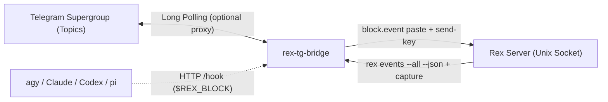

# rex-tg-bridge

24/7 **Telegram Forum Topics ↔ [Rex Server](https://www.superlogical.com/rex)** bridge for terminal coding agents (**Antigravity CLI (`agy`)**, **Claude Code**, **Codex CLI**, **pi**, and generic terminal programs).

Run it directly on your Linux server alongside `rex.service` (`systemd --user` + `loginctl enable-linger`) so every Rex session maps 1:1 to a Telegram Forum Topic — accessible from your phone 24/7 even when your laptop is asleep.

## Features

- **1 Rex Session = 1 Telegram Forum Topic**
  - Creating, renaming, or destroying a Rex session automatically creates, renames, or deletes the corresponding Telegram Topic.
  - Closing or renaming a Topic in Telegram automatically kills or renames the corresponding Rex session.
  - Per-session locking prevents duplicate topic creation under concurrent events.
- **Bidirectional Agent Messaging**
  - Send any text directly in a Topic → injected cleanly via Rex `block.event` (`paste`, multiline & CJK safe) + `enter`.
  - Reply to any pushed message to route back to that exact `block_id` in multi-pane sessions, or switch panes with `/panes`.
  - Inline action buttons for approvals, choices, screen capture, and `Ctrl+C`.
- **Dual-Channel Outbound Forwarding (Structured Hook + Rex Events Fallback)**
  - **Structured Hooks (`http://127.0.0.1:18790/hook`)**:
    - **Antigravity CLI (`agy`)**: `Stop` (extracts clean final Markdown reply from `transcript_full.jsonl`) + `PreToolUse` (`ask_question` choices forwarded with quick buttons).
    - **Claude Code**: `Stop`, `Notification`, `PermissionRequest`.
    - **Codex CLI**: `notify` (`agent-turn-complete`).
    - **Any script / agent (`pi`, `opencode`, etc.)**: `rex-tg-notify "message"`.
  - **Rex Native Event Fallback (`rex events --all --json`)**: listens to OSC 7501 `program_status_changed` (`done` / `blocked` / `error`), `desktop_notification`, `bell`, and `child_exited` with automatic TUI chrome scrubbing and hook-race deduplication.
- **Zero External Dependencies**: Pure Node.js CLI + Python 3 stdlib daemon. Supports HTTP/HTTPS proxies (`TG_PROXY`) and custom Telegram Bot API reverse proxies (`TG_API_BASE`, e.g. Cloudflare Workers).

## Architecture



## Requirements

- [Rex Server](https://www.superlogical.com/rex/docs) (`rex` in `PATH`)
- Node.js `>= 18`
- Python `>= 3.10` (standard library only, no `pip install`)

## Quick Start

### 1. Install

```bash
npm install -g rex-tg-bridge
```

### 2. Create a Telegram Bot & Forum Group

1. Create a bot in `@BotFather` and copy the **Bot Token**.
2. Create a private Telegram group → enable **Topics** in group settings.
3. Add your bot to the group as an **Administrator** and enable **Manage Topics**.

### 3. Configure Hooks & 24/7 systemd Service (Linux)

```bash
# Install agy hooks + systemd user service + env template
rex-tg-bridge setup --agent agy --systemd

# Add your TG_BOT_TOKEN (and TG_PROXY if needed)
nano ~/.config/rex-tg-bridge/env

# Keep user services alive after logout (24/7)
loginctl enable-linger "$USER"

# Enable & start
systemctl --user enable --now rex-tg-bridge.service
```

Or run in foreground directly:

```bash
TG_BOT_TOKEN="123456:ABC..." rex-tg-bridge start
```

### 4. Bind Your Group

Send `/bind` in the `# General` topic of your Telegram supergroup.  
The bridge locks authorization exclusively to your Telegram user ID and automatically creates Topics for all live Rex sessions.

## Telegram Commands

| Command | Scope | Description |
| --- | --- | --- |
| `/bind` | Supergroup | Bind group & owner on first setup |
| `/unbind` | Bound group | Reset binding |
| `/sync` | Bound group | Sync live Rex sessions to Topics and remove stale ones |
| `/sessions`, `/ls` | Bound group | List live Rex sessions and foreground programs |
| `/new <name> [cmd]` | Bound group | Create a new Rex session (e.g. `/new fix-api agy`) |
| *(plain text)* | Session Topic | Paste & press Enter into target pane (Reply routes to exact block) |
| `/screen [N]`, `/s` | Session Topic | Capture terminal content with TUI noise scrubbed |
| `/rawscreen [N]` | Session Topic | Raw uncleaned terminal capture |
| `/panes` | Session Topic | List and switch active pane in the session |
| `/key <keys...>` | Session Topic | Send key presses (e.g. `/key ctrl+c`, `/key esc`) |
| `/raw <text>` | Session Topic | Paste text without pressing Enter |
| `/rename <name>` | Session Topic | Rename both the Rex session and the Topic |
| `/kill` | Session Topic | Close Rex session (with confirmation) and delete Topic |

## Multi-Agent Hook Integration

Run `rex-tg-bridge setup --agent all` to print or install hook snippets for all supported agents, or inspect `rex-tg-bridge hooks-path`:

- **Antigravity CLI (`agy`)**: automatically configured in `~/.gemini/config/hooks.json` by `rex-tg-bridge setup --agent agy`.
- **Claude Code**: add `claude_hook.py` to `~/.claude/settings.json` (`Stop`, `Notification`, `PermissionRequest`).
- **Codex CLI**: add `notify = ["python3", "<hooks-path>/codex_hook.py"]` to `~/.codex/config.toml`.
- **Any Agent / Shell Script**:
  ```bash
  rex-tg-notify --title "Build" --status done "All tests passed!"
  ```

## Environment Variables

See [`.env.example`](./.env.example).

| Variable | Default | Description |
| --- | --- | --- |
| `TG_BOT_TOKEN` | *(required)* | Telegram Bot Token |
| `TG_PROXY` | `""` (falls back to `HTTPS_PROXY`) | HTTP/HTTPS proxy URL |
| `TG_API_BASE` | `https://api.telegram.org` | Custom Bot API base URL |
| `HOOK_HOST` | `127.0.0.1` | Local HTTP hook bind host |
| `HOOK_PORT` | `18790` | Local HTTP hook bind port |
| `STATE_FILE` | `~/.local/state/rex-tg-bridge/state.json` | Persistent mapping file |
| `REX_BIN` | auto-detected `rex` | Path to `rex` CLI binary |
| `CAPTURE_LINES` | `45` | Default `/screen` line count |

## License

MIT
